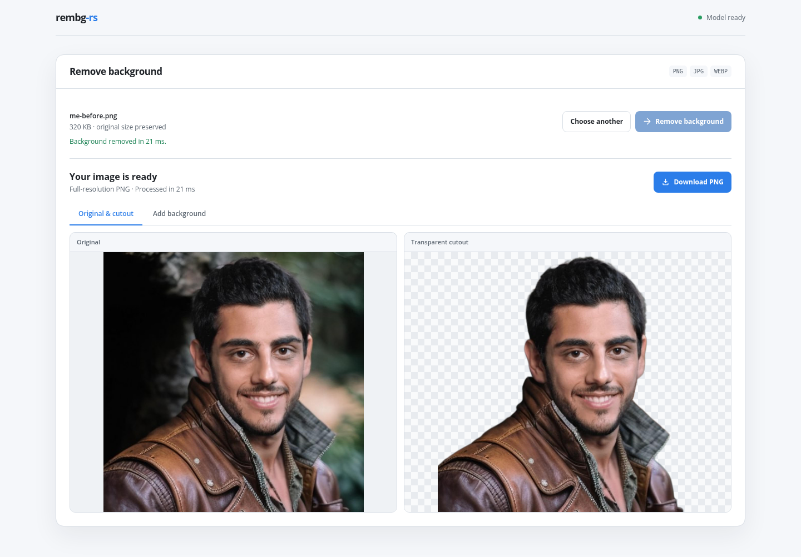

# rembg-rs

**Bria RMBG-3.0 background removal in native Rust.** Install a prebuilt executable with Homebrew, apt, or pacman. Run it locally from the command line, the built-in web UI, or an HTTP endpoint.

[Project site](https://rembg-rs.apiplant.com/) · [Documentation](https://rembg-rs.apiplant.com/docs) · [Performance notes](docs/performance.md) · [RMBG-3.0 model card](https://huggingface.co/briaai/RMBG-3.0)

> **Model license:** Bria's RMBG-3.0 weights are CC BY-NC 4.0. Commercial use requires a separate Bria license. This repository's Rust code is MIT licensed.

## Install

The standard package-manager executables are CPU builds. They do not need Rust, Python, or an NVIDIA GPU. The model downloads automatically on first use and needs about 13.6 GB of disk space. Linux x86_64 CUDA packages and archives are also available.

### Homebrew

macOS Apple Silicon and Linux:

~~~sh
brew tap apiplant/tap
brew install apiplant/tap/rembg-rs
~~~

### Debian and Ubuntu

The signed apt repository is shared by ApiPlant packages. Add it once, then install and update with apt:

~~~sh
curl -fsSL https://apt.apiplant.com/apiplant-archive-keyring.gpg | sudo tee /usr/share/keyrings/apiplant.gpg >/dev/null
echo 'deb [signed-by=/usr/share/keyrings/apiplant.gpg] https://apt.apiplant.com stable main' | sudo tee /etc/apt/sources.list.d/apiplant.list >/dev/null
sudo apt update
sudo apt install rembg-rs
~~~

Supported architectures: amd64 with glibc 2.35 or newer; arm64 with glibc 2.39 or newer.
On amd64 with a compatible NVIDIA driver and CUDA runtime, install the CUDA package instead with `sudo apt install rembg-rs-cuda`.

### Arch Linux

Add the signed ApiPlant repository once:

~~~sh
curl -fsSL https://apiplant.github.io/pacman/apiplant.gpg -o /tmp/apiplant.gpg
keyid=$(gpg --show-keys --with-colons /tmp/apiplant.gpg | awk -F: '/^pub:/ {print $5; exit}')
sudo pacman-key --add /tmp/apiplant.gpg
sudo pacman-key --finger "$keyid" && sudo pacman-key --lsign-key "$keyid"
printf '\n[apiplant]\nSigLevel = Required DatabaseOptional\nServer = https://apiplant.github.io/pacman/$arch\n' | sudo tee -a /etc/pacman.conf >/dev/null
sudo pacman -Sy rembg-rs
~~~

For NVIDIA CUDA on x86_64, install `rembg-rs-cuda` instead: `sudo pacman -Sy rembg-rs-cuda`.

### Download a release archive

Prebuilt CPU archives for macOS Apple Silicon and Linux x86_64/aarch64, plus a Linux x86_64 CUDA archive, are available on the [releases page](https://github.com/apiplant/rembg-rs/releases/latest). Each archive includes the executable, README, and license.

## Quick start

Remove an image or start the local web UI. Missing model files download automatically, and interrupted downloads resume:

~~~sh
rembg-rs remove input.jpg cutout.png
rembg-rs serve
~~~

Open the URL printed by the server. Select or drop an image to preview it before processing. After removal, move and resize the cutout over a photo or a solid color. The background controls can show the full photo or crop it, and the output keeps the selected frame dimensions.

The default model directory is <code>~/.cache/rembg-rs/models/comfyui</code> (or <code>$XDG_CACHE_HOME/rembg-rs/models/comfyui</code>). Override it with <code>--models-dir PATH</code> or <code>RMBG_MODELS_DIR=PATH</code>. Run <code>rembg-rs fetch-comfy</code> to download the model before the first inference request. The public INT8 bundle does not require an HF token.

## CLI and HTTP API

The server keeps one model loaded. The browser interface is served at <code>/</code>, <code>GET /health</code> is a readiness check, and <code>POST /remove</code> accepts raw image bytes and returns a full-size PNG with the predicted matte in its alpha channel.

~~~sh
curl --data-binary @input.jpg \
  -H 'Content-Type: image/jpeg' \
  http://127.0.0.1:8080/remove -o cutout.png
~~~

The default upload limit is 50 MiB, with one request waiting in the queue. Configure these with <code>--max-upload-mib</code>, <code>--queue-size</code>, <code>RMBG_MAX_UPLOAD_MIB</code>, and <code>RMBG_QUEUE_SIZE</code>. Bind to localhost for local use; put a trusted access layer in front of the server before exposing it publicly.

## CUDA and performance

The standard packages use CPU inference. On Linux x86_64, install <code>rembg-rs-cuda</code> from apt or pacman after adding the same repository, or use the CUDA archive. The host needs an NVIDIA driver and CUDA runtime compatible with the release build. The denoiser keeps official INT8 ConvRot weights packed on the GPU, row-quantizes activations, runs INT8 tensor-core GEMMs, and dequantizes results to BF16.

The FLUX.2 VAE defaults to <code>auto</code> placement: it uses CUDA only when at least 22 GiB of VRAM is free at startup; otherwise it runs on CPU. Set <code>--vae-device cpu</code>, <code>same</code>, <code>cuda</code>, or <code>cuda:N</code> to choose explicitly. Qwen3-VL encoding currently runs on CPU.

Measured on an RTX 4090 with the same 1410 × 1080 image and model bundle:

| Implementation | Warm median |
| --- | ---: |
| Native Rust CUDA path | **15.967 s** |
| ComfyUI <code>AILab_RMBG3</code> native INT8 path | 17.891 s |

The Rust median was 10.8% lower in this run. These end-to-end request timings include PNG transfer. See [the measurements and method](docs/performance.md).

## Building from source

Install the Rust stable toolchain, then build the portable CPU binary:

~~~sh
cargo build --release --locked
~~~

CUDA builds on supported NVIDIA/Linux systems:

~~~sh
cargo build --release --locked --features cuda
~~~

The <code>cuda-cudnn</code> feature additionally requires the CUDA toolkit, NVCC, and cuDNN. The website is built from <code>website/</code> with <code>pnpm install --frozen-lockfile && pnpm build</code>.

## Library use

The model components are exposed as <code>rembg_rs::{Checkpoint, Qwen3Encoder, Fibo2Transformer, Flux2Vae, NativePipeline}</code>:

~~~rust
let pipeline = NativePipeline::load(&rembg_rs::default_models_dir(), "cuda")?;
let matte = pipeline.remove_background(&image)?;
~~~

## License

The code in this repository is MIT licensed. RMBG-3.0 weights are licensed CC BY-NC 4.0; the non-commercial restriction applies to the weights and their use. Obtain a commercial license from Bria before commercial use. See the [model card](https://huggingface.co/briaai/RMBG-3.0) and [Bria licensing](https://bria.ai/license/).
